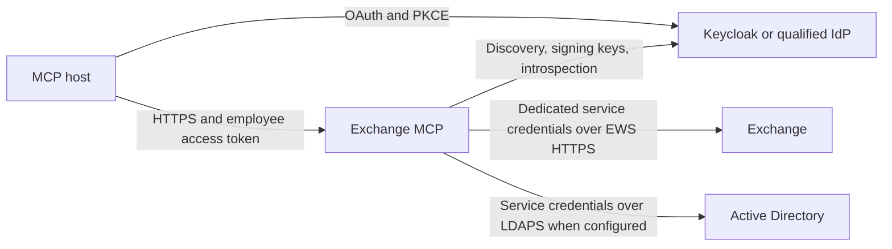

# Exchange MCP

`exchange-mcp` is an open-source, self-hosted MCP server for working with on-premises Microsoft Exchange mailboxes through EWS. A capable MCP host authenticates the employee through the operator's identity provider; the service then acts within that employee's enrolled mailbox and verified delegated permissions using a separate, scoped Exchange service account.

This public source release is version **1.16.8**, licensed under **Apache-2.0**. It contains the service, checks, Docker build, a conservative Compose example, and operator/client documentation. It includes no production credentials, CA certificates, deployment endpoints, employee records, or hosted service. Build and operate your own deployment. The public Docker recipe requires operator qualification; this source-only package does not claim that a newly built container or the example configuration has been live-tested.

**A properly configured IdP and Exchange service identity are prerequisites.** The container alone does not supply SSO, AD federation, client registration, mailbox permissions, public HTTPS, or a ready-to-use ChatGPT connection. The implemented token-status contract targets Keycloak; another OIDC provider needs matching behavior or a separately qualified adapter. Start with [the identity requirements](docs/IDENTITY-PROVIDER.md).

## Read in this order

| You are doing this | Read |
| --- | --- |
| Planning identity, SSO, enrollment, scopes, or revocation | [Identity provider and authorization contract](docs/IDENTITY-PROVIDER.md) |
| Configuring Keycloak clients, scopes, GUID mapping, or browser SSO | [Keycloak administrator setup](docs/KEYCLOAK.md) |
| Deploying a Linux Docker Compose instance | [Deployment, verification, backup, and rollback](docs/DEPLOYMENT.md) |
| Choosing or reviewing every application setting | [Configuration reference](docs/CONFIGURATION.md) |
| Connecting Codex, ChatGPT, or another MCP host | [Client setup and capability boundaries](docs/CLIENTS.md) |
| Reviewing exact workflows and unsupported cases | [Features and limitations](docs/FEATURES-AND-LIMITATIONS.md) |
| Building or changing the source | [Build and test](docs/BUILD-AND-TEST.md), [release verification](docs/RELEASE-VERIFICATION.md), [Contributing](CONTRIBUTING.md) |
| Reviewing exposure or reporting a vulnerability | [Security](SECURITY.md) |
| Reviewing release changes or preparing publication | [Changelog](CHANGELOG.md), [Publishing](docs/PUBLISHING.md) |

All `.example.test` hostnames, sample subjects, and Alice/Bob mailboxes are fictional placeholders. Replace them consistently. This is an administrator-deployed service, not a one-command employee installation.

## How the pieces fit

The employee token identifies and authorizes the employee at the MCP boundary. It is not forwarded to Exchange as an EWS credential. Browser Kerberos/SPNEGO, when deliberately configured at the IdP, is separate from the service's EWS/LDAPS authentication. There is no browser-ticket bridge or Outlook desktop automation.

Each authenticated request checks the JWT, configured issuer and receiving-host audience, approved OAuth client, token expiry, and fresh Keycloak-style introspection. Mailbox access additionally requires the required scope and an enrollment. Automatic enrollment verifies a signed AD GUID against the current AD user mailbox; delegated operations require current access evidence rather than a user-supplied mailbox address.

## Implemented areas

The live tool catalog is the authority for an installed version and its current scopes. The source includes these areas; this table is an inventory, not a claim that every workflow has been validated against every Exchange build or MCP host.

| Area | Examples and boundaries |
| --- | --- |
| Mail | Folder listing/search, message reads, flags/categories, drafts, reply/forward, attachments, moves, deletion, guarded sending, and native recall/status paths. Recipient policy, size limits, current handles, and Exchange behavior apply. |
| Draft and signature review | Authenticated draft previews; optional MCP Apps email/signature views; signature capture/preview/approval; saved profiles, defaults, and use rules. UI display depends on the host. |
| Calendar | Calendar/item operations, meeting response/cancellation paths, availability, rooms, and meeting-time discovery. Transmission or access-changing operations retain their specific guards. |
| Contacts | Contacts, contact groups and folders, and directory resolution. This is the exposed EWS surface, not all Outlook address-book functionality. |
| Tasks | Task CRUD/completion, assignment plans and native task-notice/status handling. Background task-notice processing is a separate disabled-by-default operator choice. |
| Settings and sharing | Selected mailbox settings, Inbox rules, folder permissions, delegates, and permission-backed mailbox discovery. Unknown or incomplete rights are not grants. |
| Incoming-mail events | Own-Inbox `email.received`, Exchange streaming/reconciliation, verified signed HTTPS webhooks, private durable subscription state, and a read-only status tool. A supporting event-capable host is required. |
| Operations | Tracking IDs, bounded metadata audit records, per-user/global admission limits, persistent approval/replay state, and fail-closed token/directory checks. |

The example starts with **writes disabled**, **sending disabled**, **automatic enrollment disabled**, and **background task-notice processing disabled**. A static pilot mapping still has to be replaced with a verified employee subject. Scopes alone do not switch on writes or sending, and a server switch does not grant Exchange rights.

Signatures and onboarding settings are stored in the employee's Exchange mailbox. The host does not need to modify Outlook's local signature files. The private state mount holds operational data such as enrollments, approvals/replay protection, event state, and keys; preserve it across replacements.

## First deployment outline

Follow the complete commands and checks in [DEPLOYMENT.md](docs/DEPLOYMENT.md). The required sequence is:

1. Operate an HTTPS IdP and configure its employee access policy, PKCE client, resource audience, scopes, and confidential introspection client. [KEYCLOAK.md](docs/KEYCLOAK.md) gives concrete admin steps.
2. Provision a dedicated Exchange service account with administrator-reviewed impersonation scope for intended actors and the needed directory read access. Verify a pilot mailbox; an IdP role does not grant this backend access.
3. Obtain this source release in a dedicated Linux directory. Install Docker Engine and Compose v2 through the supported distribution procedure.
4. Create private local configuration and secret files, plus a persistent state directory owned by the container UID/GID `1654:1654`. Replace every example value and keep the initial read-only gates.
5. Supply operator-approved CA certificates in `certs/` when backend private PKI requires them, then build the image locally. No private CA is shipped.
6. Start the single `mcp` service, then configure the host's HTTPS reverse proxy. The Compose listener binds only to `127.0.0.1:8080`; preserve the intended Host and trust only the actual immediate proxy.
7. Check process health, HTTPS metadata, expected unauthenticated challenge, Alice's authenticated profile/read, and rejection for an unapproved identity. These are distinct checks.
8. Connect the actual client and qualify refresh, write approval, delegated access, preview UI, and events separately when required. Capture a tested backup/rollback before enabling wider or mutable use.

Do not publish a container port, broaden Exchange impersonation, approve all OAuth clients, or grant offline access merely to work around a failed check. Fix the specific missing prerequisite.

## Client and host boundaries

A basic Streamable HTTP host can use the supported tools once its OAuth contract is correct. Advanced capabilities need separate qualification:

- **Sending:** the exact stable ChatGPT CIMD client ID uses `mail.send` OAuth authorization and the host's normal tool approval. Other clients normally need native form elicitation on an MRTR/stateful session, unless a deliberately configured narrow standing grant applies. Do not promise a per-draft confirmation form for every client.
- **Preview UI:** MCP Apps HTML/resource/bridge support and host sandbox behavior determine whether inline cards or optional views display. Successful `resources/read` is not proof of visible UI.
- **Events:** own-Inbox events require MCP `2026-07-28`, host-managed subscription/renewal, and outward access to the host's public HTTPS callback. Callback acceptance does not prove task execution or an immediate alert.
- **Refresh:** the host stores and refreshes its OAuth grant. The server's optional continuation helper cannot prove silent renewal or a fixed multi-day session.
- **Hosted connectivity:** a cloud runtime needs its own route to MCP and the IdP. A user's local VPN/browser access is not that route.

The source emits EWS requests using the `Exchange2016` schema version. That is a protocol choice, not certification of every Exchange version, lifecycle status, native client, or task/recall workflow. Exchange Online/Graph, arbitrary IdPs, distributed HA, every Outlook feature, and every host UI/event surface are not promised by this release.

## Operate one instance with durable state

Use one application instance and one active signature writer. Admission limits, preview/session caches, EWS UserConfiguration update guards, and local file state are not a distributed coordination system. Do not scale replicas or add a load balancer as an HA claim without a separately reviewed shared-state, locking, session, and rate-limit design.

Preserve `state/`, the matching keys, configuration, and mounted secrets. Backups contain sensitive operational data and must remain private. Reverting application state does not undo mail already sent or Exchange changes already accepted. Reconcile uncertain sends before retrying; a clean restart is not proof that a previous operation was not dispatched.

See [SECURITY.md](SECURITY.md) for trust boundaries, credential handling, incident evidence, and private vulnerability reporting. See [BUILD-AND-TEST.md](docs/BUILD-AND-TEST.md) for source checks and the boundary between local fixture coverage and live deployment qualification.

## License and attribution

The project's code is under the [Apache License 2.0](LICENSE). Retain [NOTICE](NOTICE), [THIRD-PARTY-NOTICES.md](THIRD-PARTY-NOTICES.md), and the relevant [dependency license materials](licenses/) when redistributing. Dependencies retain their own licenses. Product names identify interoperability targets and do not imply endorsement by Microsoft, OpenAI, or Keycloak.

